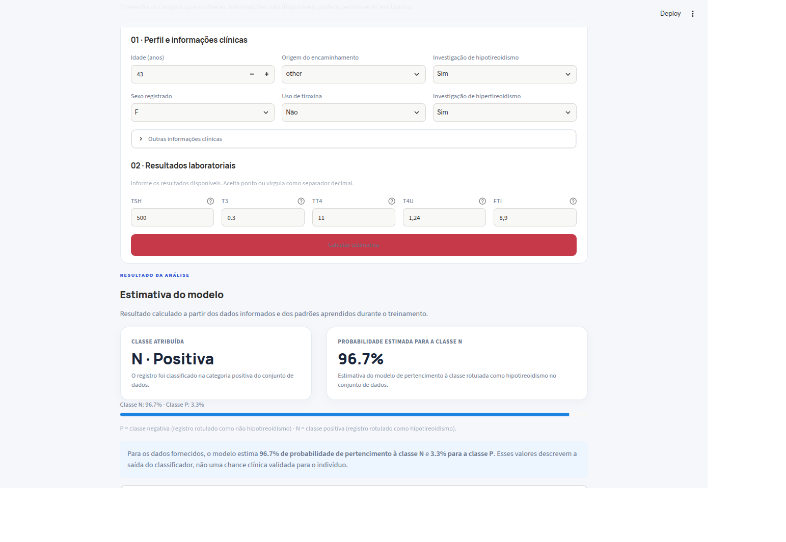

# Diagnóstico de Hipotireoidismo

Projeto desenvolvido como parte da formação em **Ciência de Dados da EBAC**, com foco em análise exploratória de dados e modelagem de classificação binária aplicada à base `Hypothyroid.csv`.

O trabalho investiga os dados disponíveis, realiza a preparação para modelagem, compara algoritmos de Machine Learning e avalia a capacidade dos modelos de reproduzir a variável-alvo `binaryClass`.

> **Nota de escopo:** os modelos foram desenvolvidos para reproduzir os rótulos presentes na base. Os resultados não constituem validação clínica de diagnóstico de hipotireoidismo e não substituem avaliação profissional.

---

## Visão geral

### Objetivos

- Caracterizar a base e investigar a distribuição das variáveis.
- Identificar valores ausentes, duplicidades, valores inválidos e atributos sem variabilidade.
- Analisar diferenças entre as classes e relações entre os atributos.
- Preparar os dados com separação entre treinamento e validação reservada.
- Comparar modelos de classificação por validação cruzada estratificada.
- Investigar a importância dos atributos e a sensibilidade dos modelos à retirada de TSH.
- Avaliar os modelos finalistas em dados não utilizados durante o desenvolvimento.

### Base de dados

A base utilizada é `Hypothyroid.csv`, originalmente composta por **3.772 registros e 30 colunas**.

Os atributos incluem informações demográficas, histórico de tratamentos e procedimentos relacionados à tireoide, indicadores de realização de exames, resultados laboratoriais e a variável-alvo `binaryClass`.

A variável `binaryClass` possui duas categorias:

| Rótulo | Codificação na modelagem | Interpretação | Registros originais |
|:---:|:---:|---|---:|
| `P` | 0 | Classe negativa | 3.481 (92,29%) |
| `N` | 1 | Classe positiva | 291 (7,71%) |

A classe `N` foi definida como positiva para o cálculo das métricas de Precision, Recall, F1 e PR-AUC. A interpretação clínica dos rótulos depende da documentação de sua construção.

---

## Etapas do projeto

### 1. Análise exploratória e preparação dos dados

A análise exploratória investigou:

- Distribuição das variáveis numéricas e categóricas;
- Distribuição da variável-alvo;
- Valores ausentes e assimetria;
- Duplicidades e valores inválidos;
- Diferenças entre as classes;
- Correlação entre variáveis numéricas;
- Associação entre variáveis categóricas e a classe.

Na preparação, foram removidas as 61 duplicatas excedentes, o valor inválido de idade foi convertido em ausente, e as variáveis `TBG` e `TBG measured` foram excluídas. Após esses procedimentos, a base analítica ficou com **3.711 registros**.

A divisão estratificada, com 80% para treinamento e 20% para validação reservada (`random_state=42`), resultou em:

| Conjunto | Registros |
|---|---:|
| Treinamento | 2.968 |
| Validação reservada | 743 |
| **Total** | **3.711** |

A validação reservada foi mantida separada durante o desenvolvimento, sendo utilizada somente na avaliação final dos modelos selecionados.

### 2. Modelagem

Foram comparados quatro classificadores:

- Dummy Classifier;
- Regressão Logística;
- Random Forest;
- XGBoost.

O pré-processamento foi integrado aos pipelines, com imputação de valores ausentes e transformações específicas para variáveis numéricas, binárias e categóricas.

A comparação foi realizada com **validação cruzada estratificada de cinco folds**, utilizando `shuffle=True` e `random_state=42`.

As métricas adotadas foram:

- Precision;
- Recall;
- F1;
- PR-AUC;
- ROC-AUC.

### 3. Interpretação e avaliação

Após a comparação, XGBoost e Random Forest foram selecionados como modelos finalistas. Também foram realizadas análises de importância por permutação, um experimento de sensibilidade sem a variável TSH e testes de associação entre variáveis categóricas e a classe.

Os modelos finalistas foram ajustados com todo o conjunto de treinamento e avaliados nos 743 registros reservados.

---

## Resultados

### Validação cruzada

| Modelo | Precision | Recall | F1 | PR-AUC | ROC-AUC |
|---|---:|---:|---:|---:|---:|
| Dummy | 0,000 | 0,000 | 0,000 | 0,079 | 0,500 |
| Regressão Logística | 0,723 | 0,940 | 0,817 | 0,875 | 0,989 |
| Random Forest | 0,926 | 0,991 | 0,957 | 0,990 | 0,999 |
| XGBoost | 0,958 | 0,974 | 0,966 | 0,976 | 0,996 |

### Avaliação na validação reservada

| Modelo | Precision | Recall | F1 | PR-AUC | ROC-AUC |
|---|---:|---:|---:|---:|---:|
| XGBoost | 1,000 | 0,983 | 0,991 | 1,000 | 1,000 |
| Random Forest | 0,983 | 1,000 | 0,992 | 1,000 | 1,000 |

Cada modelo finalista apresentou apenas um erro de classificação na validação reservada: o XGBoost registrou um falso negativo, enquanto o Random Forest registrou um falso positivo.
<div style="background-color: #DBEAFE; padding: 12px; border-radius: 6px;">

### Achados da interpretação

- TSH apresentou a maior importância por permutação nos modelos avaliados.
- A retirada de TSH provocou redução expressiva do desempenho dos três modelos.
- Sem TSH, TT4, FTI e T3 passaram a concentrar maior importância relativa.
- `on thyroxine` e `query hypothyroid` apresentaram associação estatística com a classe, mas com baixa intensidade segundo o V de Cramer.
</div>

### Limitações e cuidados de interpretação

- A origem e o procedimento de construção de `binaryClass` não foram estabelecidos de forma independente. Caso TSH tenha participado da definição dos rótulos, pode existir circularidade ou vazamento de informação; os resultados disponíveis não permitem confirmar essa hipótese.
- A validação reservada pertence à mesma base de origem do treinamento. Não foi realizada validação externa em outra população ou instituição.
- A classe positiva possui 233 registros no treinamento e 58 na validação reservada, o que limita a precisão das estimativas.
- A importância por permutação representa contribuição preditiva no contexto dos modelos, não causalidade.
- O desempenho observado demonstra capacidade de reproduzir os rótulos do conjunto avaliado; não comprova eficácia diagnóstica ou generalização clínica.

---

## Aplicação demonstrativa

Além dos notebooks analíticos, o projeto inclui uma aplicação Streamlit para demonstrar a inferência com o pipeline final de Random Forest.

A aplicação está em `app/app.py` e utiliza o artefato `models/modelo_hipotireoidismo.joblib`. Ela recebe informações demográficas, clínicas e laboratoriais, organiza os dados conforme os 26 preditores esperados e apresenta a classe prevista e a probabilidade estimada de pertencimento à classe positiva `N`.



A interface foi organizada em três áreas principais:

- **Perfil e informações clínicas:** reúne dados demográficos e indicadores clínicos disponíveis no conjunto de dados.
- **Resultados laboratoriais:** permite informar TSH, T3, TT4, T4U e FTI. Os campos podem permanecer sem preenchimento quando a informação não estiver disponível.
- **Estimativa do modelo:** apresenta a classe atribuída (`P` ou `N`) e a saída probabilística estimada para a classe `N`.

A aplicação também disponibiliza valores ilustrativos para facilitar a experimentação. Eles permitem observar como diferentes combinações de atributos afetam a saída do classificador, mas não representam faixas clínicas ou critérios diagnósticos.

**Interpretação dos rótulos:**

- `N`: classe positiva — registro rotulado como hipotireoidismo na base.
- `P`: classe negativa — registro rotulado como não hipotireoidismo.

O percentual apresentado é a saída probabilística do classificador para a classe `N`. Não corresponde a uma probabilidade clínica individual validada, não deve ser interpretado como risco pessoal e não constitui diagnóstico.

### Acesse o aplicativo

A versão atual do protótipo está disponível online:

[**Diagnóstico de Hipotireoidismo — Aplicativo web**](https://diagnosticohipotireoidismo.streamlit.app/)

### Estrutura atual da aplicação

```text
app/
└── app.py

models/
└── modelo_hipotireoidismo.joblib

src/
├── __init__.py
└── preprocessing.py

treinar_modelo.py
```

### Gerar o artefato do modelo

Na raiz do projeto, com o ambiente Python ativado e as dependências instaladas, execute:

```bash
python treinar_modelo.py
```

O script utiliza `data/df_treino.csv`, reconstrói o pipeline final documentado no estudo e salva o modelo em `models/modelo_hipotireoidismo.joblib`. A função `codificar_binarias` está em `src/preprocessing.py`, módulo compartilhado entre treinamento e aplicação.

### Instalar dependências da aplicação

```bash
python -m pip install streamlit joblib numpy pandas scikit-learn
```

Instale também as dependências exigidas pelo pipeline final, incluindo `xgboost` caso ele esteja presente no ambiente de treinamento ou no artefato. Recomenda-se executar treinamento e aplicação no mesmo ambiente Conda, mantendo versões compatíveis de `scikit-learn`.

### Iniciar o Streamlit

```bash
python -m streamlit run app/app.py
```

A aplicação carrega o modelo existente e realiza somente inferência. Não executa treinamento ou reavaliação dos algoritmos a cada acesso.

### Perfis ilustrativos

A interface disponibiliza valores iniciais e exemplos para facilitar testes. Eles são referências de demonstração baseadas em padrões observados na base, não faixas clínicas, critérios diagnósticos ou recomendações de saúde.

---

## Estrutura do projeto

```text
Diagnostico_hipotireoidismo/
├── data/
│   ├── Hypothyroid.csv
│   ├── df_treino.csv
│   └── df_validacao.csv
├── app/
│   └── app.py
├── models/
│   └── modelo_hipotireoidismo.joblib
├── notebook/
│   ├── 01_EDA.ipynb
│   └── 02_ML.ipynb
├── src/
│   ├── __init__.py
│   ├── preprocessing.py
│   ├── utils.py
│   └── ml_utils.py
├── treinar_modelo.py
└── docs/
    ├── relatorio_geral.md
    └── figuras/
        ├── eda_01.png
        ├── ...
        ├── eda_12.png
        ├── ml_01.png
        ├── ...
        └── ml_08.png
```

A estrutura acima representa a organização prevista para a entrega. Os arquivos de dados devem estar disponíveis localmente para executar os notebooks.

---

## Como executar o projeto

### 1. Clonar o repositório

```bash
git clone <URL_DO_REPOSITORIO>
cd Diagnostico_hipotireoidismo
```

### 2. Criar e ativar um ambiente Python

Exemplo utilizando Conda:

```bash
conda create -n hipotireoidismo python=3.11
conda activate hipotireoidismo
```

### 3. Instalar as dependências

As bibliotecas utilizadas nos notebooks incluem:

```bash
pip install numpy pandas matplotlib seaborn scipy scikit-learn xgboost jupyter ipykernel
```

### 4. Disponibilizar os dados

Mantenha `Hypothyroid.csv` no diretório `data/`. Os arquivos `df_treino.csv` e `df_validacao.csv` são utilizados pelo notebook de modelagem, conforme a etapa de preparação documentada no projeto.

### 5. Executar os notebooks

Abra o Jupyter:

```bash
jupyter notebook
```

Execute os notebooks na seguinte sequência:

1. `notebook/01_EDA.ipynb` — análise exploratória, preparação e geração dos conjuntos de treinamento e validação.
2. `notebook/02_ML.ipynb` — pipelines, validação cruzada, comparação e avaliação dos modelos.

> Os caminhos e nomes dos arquivos devem ser mantidos conforme a estrutura do projeto. Caso a organização local seja diferente, ajuste os caminhos de leitura nos notebooks.

---

## Documentação e tecnologias

### Documentação complementar

- [Relatório geral](docs/relatorio_geral.md): dados, EDA, preparação, metodologia, resultados, interpretação e limitações.
- [Documentação dos notebooks](notebook/README.md): finalidade, dependências e sequência de execução.
- [Figuras](docs/figuras/): visualizações utilizadas no relatório.

### Tecnologias utilizadas

- Python
- Jupyter Notebook
- Pandas e NumPy
- Matplotlib e Seaborn
- SciPy
- Scikit-learn
- XGBoost
- Streamlit

---

## Considerações finais

O projeto documenta um fluxo de Ciência de Dados que abrange entendimento dos dados, análise exploratória, preparação, validação cruzada, comparação de modelos, interpretação e avaliação final.

Os resultados devem ser compreendidos dentro dos limites da base e da variável-alvo disponíveis. A aplicação em contexto clínico exigiria esclarecimento da origem dos rótulos e validação independente, além de avaliação por profissionais habilitados.

---

## Repositório

Endereço do GitHub: **[Diagnostico_hipotireoidismo](https://github.com/albertoakel/EBAC/tree/master/Diagnostico_hipotireoidismo)**.

## Licença de uso

Este projeto é disponibilizado sob a licença **MIT**, permitindo o uso, cópia, modificação e distribuição do código, inclusive para fins comerciais, desde que os avisos de direitos autorais e a licença sejam preservados.

A licença se aplica ao código desenvolvido neste repositório. Bases de dados, bibliotecas, modelos e demais recursos de terceiros permanecem sujeitos às respectivas licenças e condições de uso.

Consulte o arquivo [LICENSE](LICENSE) para conhecer os termos completos.

## Uso de Inteligência Artificial

Ferramentas de Inteligência Artificial generativa, incluindo modelos de linguagem (LLMs), foram utilizadas como apoio ao desenvolvimento deste projeto, especialmente em atividades de:

- Revisão e organização da documentação;
- Auxílio na implementação, revisão e depuração de códigos;
- Contrução de apresentação

O uso dessas ferramentas teve caráter auxiliar. A definição das metodologias, a execução dos procedimentos, a análise crítica dos resultados e as decisões finais permaneceram sob responsabilidade do autor.

As ferramentas de IA não substituem a verificação técnica, a reprodutibilidade dos procedimentos ou a avaliação crítica dos resultados apresentados.