# Análise exploratória e modelagem preditiva para classificação de hipotireoidismo

**Projeto EBAC --- Formação em Ciência de Dados**\
**Base de dados:** `Hypothyroid.csv`\
**Variável-alvo:** `binaryClass`\
**Tipo de problema:** classificação binária

------------------------------------------------------------------------

## Resumo

Este projeto aplica técnicas de análise exploratória de dados (EDA) e
aprendizado de máquina à base `Hypothyroid.csv`, com o objetivo de
caracterizar os dados e desenvolver modelos de classificação capazes de
reproduzir os rótulos registrados na variável `binaryClass`. A base
original contém 3.772 registros e 30 colunas. Após os procedimentos de
preparação, foram obtidos 3.711 registros, divididos estratificadamente
em 2.968 observações para treinamento e 743 para validação reservada.

A variável-alvo apresenta forte desbalanceamento: a classe `P`
corresponde a 92,29% dos registros originais, enquanto a classe `N`,
definida como positiva para a modelagem, representa 7,71%. Foram
comparados Dummy Classifier, Regressão Logística, Random Forest e
XGBoost por validação cruzada estratificada em cinco folds. XGBoost e
Random Forest apresentaram os melhores resultados e foram selecionados
para avaliação final.

Na validação reservada, os dois modelos obtiveram F1 próximos de 0,99 e
apenas um erro de classificação cada. Entretanto, a análise de
importância por permutação e o experimento sem TSH evidenciaram forte
dependência preditiva dessa variável. Os resultados devem ser
interpretados como desempenho na reprodução dos rótulos existentes na
base, não como comprovação de capacidade diagnóstica clínica.

**Palavras-chave:** análise exploratória de dados; classificação
binária; hipotireoidismo; aprendizado de máquina; XGBoost; Random
Forest.

## 1. Introdução

A análise de dados clínicos pode apoiar a identificação de padrões e a
construção de modelos preditivos. Neste projeto, foi utilizada a base
`Hypothyroid.csv`, composta por informações demográficas, histórico de
tratamentos e procedimentos relacionados à tireoide, indicadores de
realização de exames e resultados laboratoriais.

A proposta inicial apresenta o problema no contexto da identificação de
casos de hipotireoidismo e da possibilidade de apoiar decisões. Contudo,
a variável disponível para treinamento é `binaryClass`, cujos rótulos
são `P` e `N`. A documentação consultada e os experimentos realizados
não estabelecem, de forma independente, o procedimento clínico utilizado
para construir essa variável. Por esse motivo, o escopo efetivamente
executado é tratado como **classificação dos rótulos existentes na
base**, e não como validação de um instrumento de diagnóstico.

O trabalho foi organizado em duas etapas principais: análise
exploratória e preparação dos dados; e modelagem, comparação,
interpretação e avaliação final dos classificadores.

## 2. Objetivos

### 2.1 Objetivo geral

Investigar as características da base `Hypothyroid.csv` e desenvolver
modelos de classificação binária para reproduzir a variável-alvo
`binaryClass`, avaliando o desempenho dos algoritmos e a contribuição
dos atributos disponíveis.

### 2.2 Objetivos específicos

- Caracterizar a distribuição das variáveis e da classe-alvo.
- Identificar valores ausentes, duplicidades, valores inválidos e
  variáveis sem variabilidade.
- Investigar diferenças entre as classes nas variáveis numéricas e
  categóricas.
- Preparar os dados e separar treinamento e validação reservada antes
  do ajuste dos transformadores.
- Comparar modelos de classificação por validação cruzada
  estratificada.
- Investigar a importância das variáveis e a sensibilidade dos modelos
  à retirada de TSH.
- Avaliar os modelos finalistas em um conjunto reservado durante o
  desenvolvimento.

## 3. Dados e definição do problema

### 3.1 Caracterização da base

A base original apresenta **3.772 registros e 30 colunas**, incluindo a
variável-alvo. Os atributos abrangem:

- idade e sexo;
- histórico de uso de tiroxina e medicação antitireoidiana;
- histórico de procedimentos e características clínicas;
- indicadores de realização de exames;
- resultados laboratoriais, como TSH, T3, TT4, T4U e FTI;
- origem do encaminhamento;
- classe `binaryClass`.

A variável-alvo possui duas categorias: `P` e `N`. Para os experimentos,
foi adotada a codificação `P = 0` e `N = 1`, considerando `N` como
classe positiva nas métricas de classificação.

  Classe        Codificação   Registros originais   Proporção

  ----------- ------------- --------------------- -----------

  P                       0                 3.481      92,29%
  N                       1                   291       7,71%
  **Total**                             **3.772**    **100%**

**Figura 1 --- Distribuição da variável-alvo na base original.**

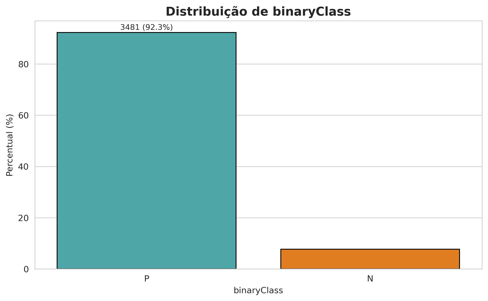

O desbalanceamento justifica o uso de métricas que considerem o
comportamento da classe minoritária, especialmente Precision, Recall, F1
e PR-AUC. A acurácia, isoladamente, não seria suficiente para
caracterizar o desempenho dos modelos.

### 3.2 Formulação da tarefa

A tarefa foi formulada como classificação binária supervisionada. Os
modelos recebem os atributos disponíveis como preditores e estimam a
classe `binaryClass`. A classe `N` foi definida como positiva para os
cálculos de Precision, Recall, F1 e PR-AUC.

Essa formulação reproduz a classificação presente no conjunto de dados.
A interpretação clínica do rótulo depende da documentação de sua
construção, que não foi confirmada de maneira independente neste
trabalho.

## 4. Análise exploratória de dados

A análise exploratória foi realizada antes da modelagem para compreender
a estrutura da base, avaliar a qualidade dos dados e identificar padrões
que orientassem a preparação e os experimentos.

### 4.1 Qualidade inicial e registros duplicados

A inspeção inicial identificou 61 registros excedentes em grupos de
duplicatas exatas, correspondentes a 33 padrões repetidos. Também foi
identificado um valor de idade igual a 455 anos, considerado inválido e
convertido em ausente na cópia analítica, sem exclusão do registro.

A variável `TBG` estava integralmente ausente, enquanto `TBG measured`
apresentava apenas uma categoria (`f`), sem variabilidade. Essas
características fundamentaram a exclusão dessas duas variáveis da base
destinada à modelagem.

**Figura 2 --- Composição dos registros e duplicidades identificadas na
base original.**

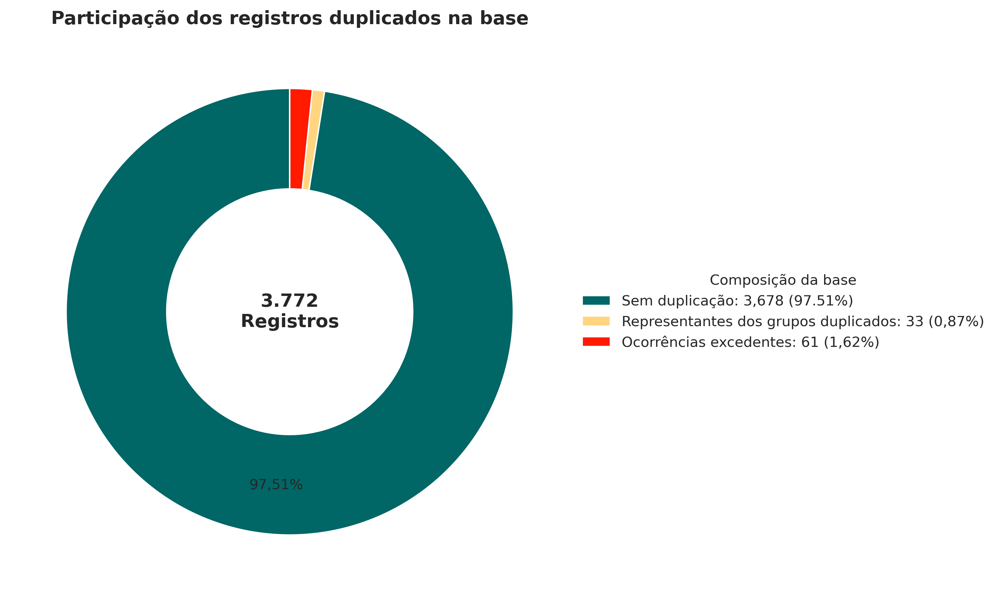

### 4.2 Distribuição das variáveis numéricas

As variáveis numéricas foram examinadas por meio de estatísticas
descritivas, histogramas e boxplots. Os exames laboratoriais apresentam
distribuições assimétricas à direita e valores extremos. O TSH se
destaca pela assimetria mais acentuada.

A presença de valores extremos não foi interpretada automaticamente como
erro. Como a análise exploratória não permite determinar se esses
valores são inconsistências ou variações legítimas, eles foram mantidos
inicialmente.

**Figura 3 --- Distribuição das variáveis numéricas por boxplots.**

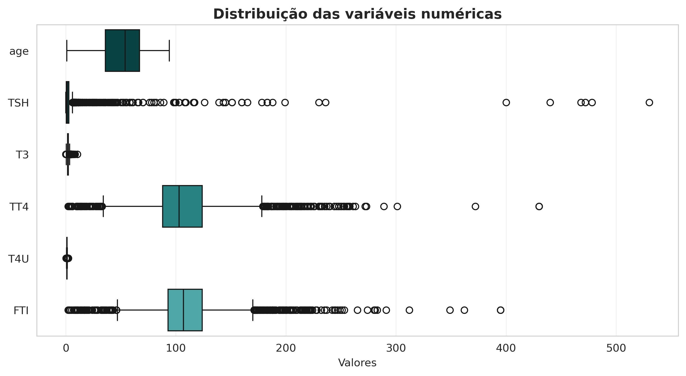

**Figura 4 --- Distribuições das variáveis numéricas por histogramas.**

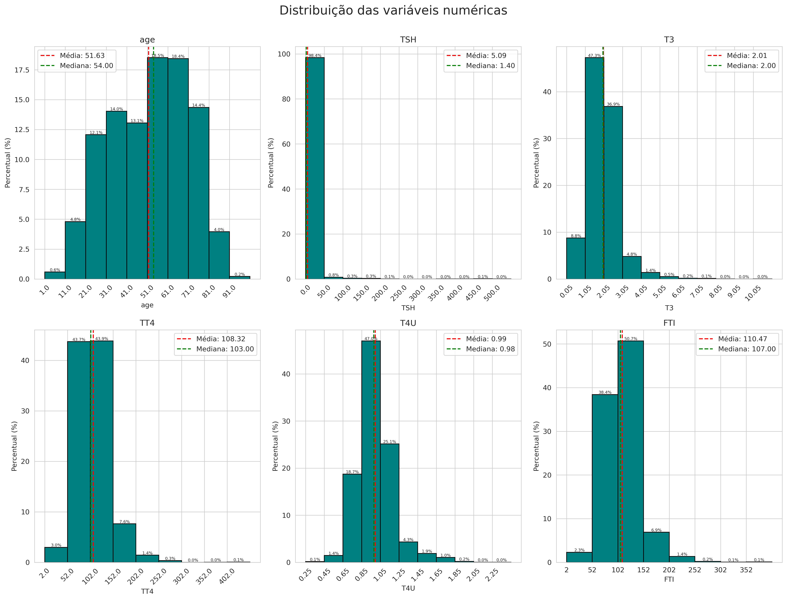

**Figura 5 --- Boxplots dos exames laboratoriais.**

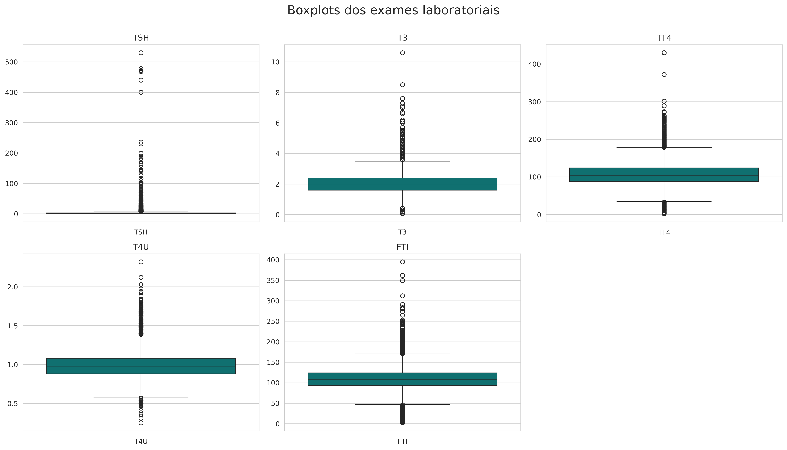

### 4.3 Comparação das variáveis numéricas entre as classes

A comparação das estatísticas descritivas mostrou diferenças mais
expressivas nos indicadores laboratoriais do que na idade. A mediana de
TSH foi 12,0 na classe `N` e 1,2 na classe `P`. Em sentido oposto, T3,
TT4 e FTI apresentaram medianas menores na classe `N`.

A idade apresentou médias próximas entre os grupos: 51,515 anos em `N` e
51,638 anos em `P`. Portanto, nessa exploração, a idade não apresentou
diferença central expressiva entre as classes.

**Figura 6 --- Distribuição das variáveis numéricas por classe.**

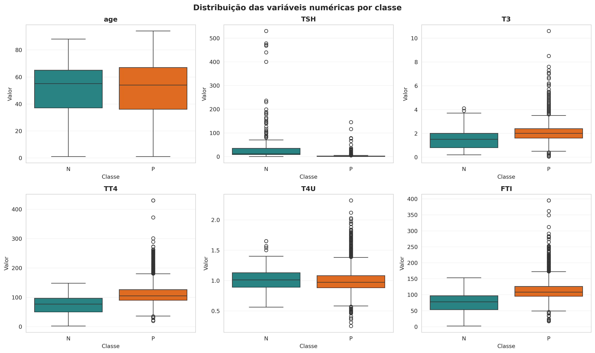

**Figura 7 --- Medianas e intervalos interquartis por classe.**

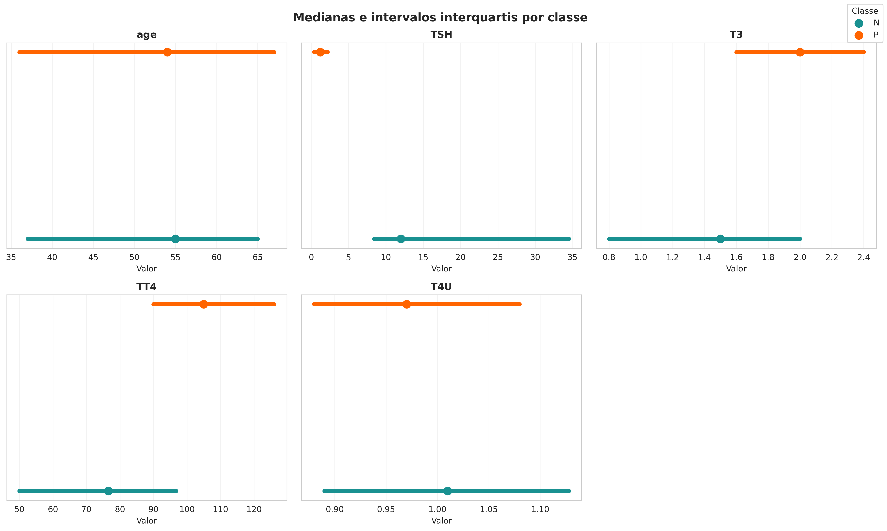

A comparação das medianas reforça a diferença observada em TSH. O
intervalo interquartil dessa variável foi de 8,4 a 34,5 na classe `N`,
enquanto na classe `P` variou de 0,4 a 2,2. Para TT4 e FTI, os
intervalos interquartis da classe `N` também se situaram em níveis
inferiores aos da classe `P`.

Essas diferenças são descritivas e exploratórias. Isoladamente, não
demonstram causalidade nem estabelecem a capacidade preditiva dos
atributos.

### 4.4 Correlação entre variáveis numéricas

Foi utilizada a correlação de Spearman para investigar associações
monotônicas entre idade e exames laboratoriais, considerando a
assimetria e os valores extremos observados.

A maior correlação positiva ocorreu entre TT4 e FTI (0,742). Também
foram observadas correlações entre T3 e T4U (0,447), TT4 e T4U (0,430) e
T3 e TT4 (0,418). A relação entre TSH e FTI foi negativa e moderada
(-0,412), enquanto idade e T3 apresentaram correlação de -0,290.

**Figura 8 --- Matriz de correlação de Spearman entre as variáveis
numéricas.**

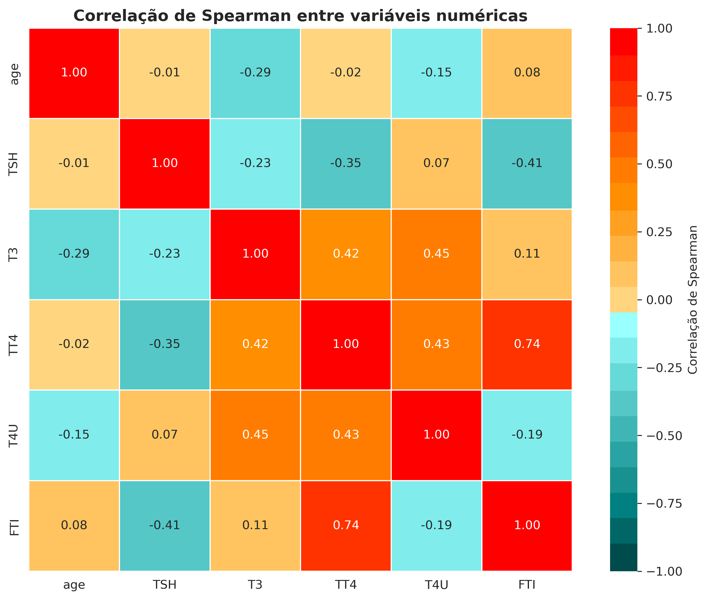

A associação entre TT4 e FTI indica sobreposição de informação entre
esses indicadores. Essa característica deve ser considerada na
interpretação da importância dos preditores. Correlação, entretanto, não
implica causalidade.

### 4.5 Valores ausentes e assimetria

Entre as variáveis numéricas, T3 apresentou a maior proporção de valores
ausentes (20,39%), seguida por T4U (10,26%), FTI (10,21%) e TSH (9,78%).
A idade apresentou duas observações ausentes após o tratamento do valor
inválido.

O TSH também apresentou a maior assimetria positiva, com coeficiente de
13,883. As demais variáveis laboratoriais apresentaram assimetria
positiva entre 1,233 e 1,731, enquanto a idade apresentou assimetria
ligeiramente negativa (-0,211).

**Figura 9 --- Assimetria e percentual de valores ausentes nas variáveis
numéricas.**

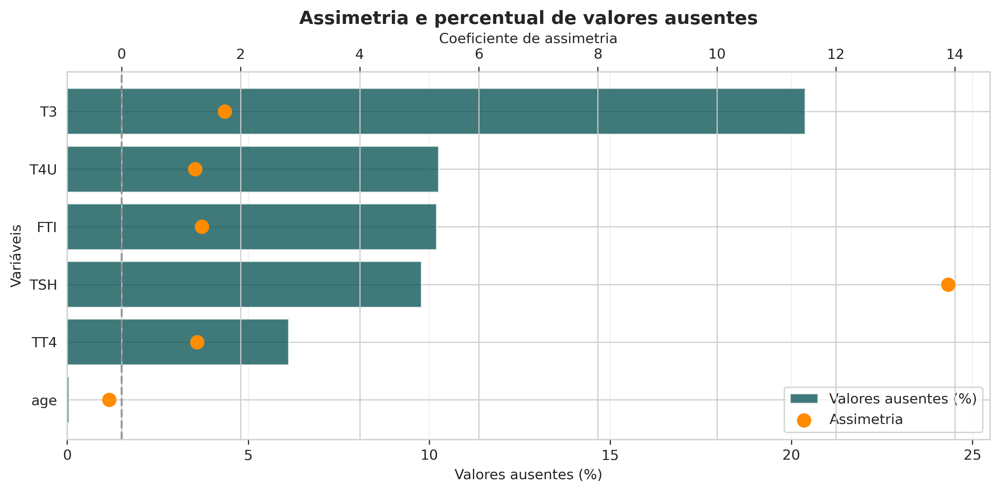

A análise conjunta indica que a imputação seria necessária para utilizar
os atributos com ausências nos pipelines de modelagem. Também reforça a
necessidade de cautela na interpretação das distribuições laboratoriais.

### 4.6 Variáveis categóricas

A classe `P` predominou em praticamente todas as categorias. Ainda
assim, algumas diferenças na composição foram observadas. Entre os
registros com `query hypothyroid = t`, por exemplo, a classe `N`
representou 16,67%, proporção superior à distribuição geral. Entre os
registros sem medição de TSH (`TSH measured = f`), todos pertenciam à
classe `P`.

Algumas categorias apresentaram baixa frequência, como
`hypopituitary = t` (1 registro), `lithium = t` (18 registros) e
`goitre = t` (34 registros). Essas frequências reduzidas exigem cautela
na interpretação das proporções.

**Figura 10 --- Composição percentual das classes nas variáveis clínicas
e categóricas.**

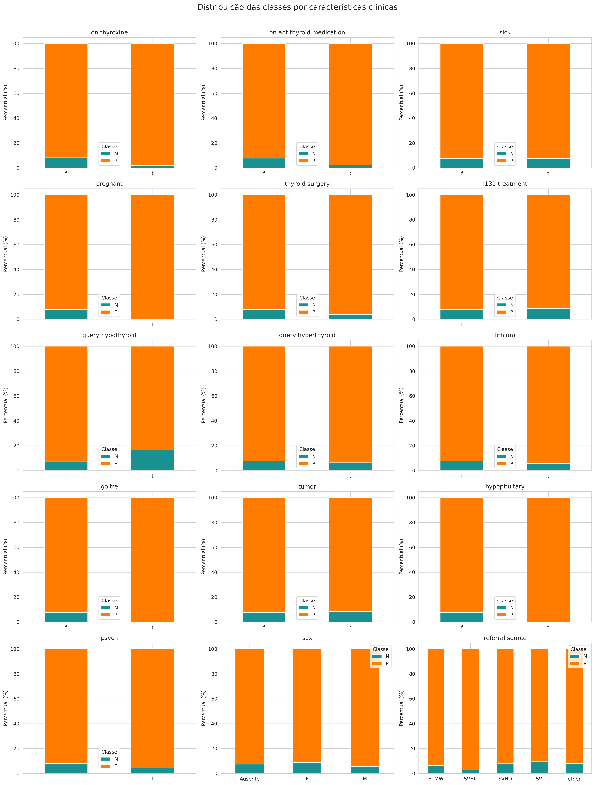

A variável `sex` apresentou 150 valores ausentes (3,98%). A maioria das
variáveis categóricas possuía duas categorias, enquanto
`referral source` apresentava cinco. A variável `TBG measured` era
constante, reforçando sua exclusão da modelagem.

**Figura 11 --- Concentração da categoria mais frequente por variável
categórica.**

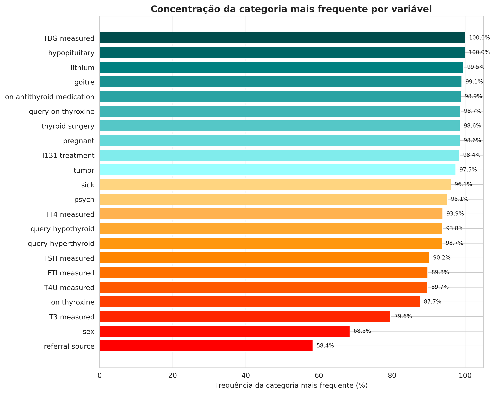

### 4.7 Síntese da análise exploratória

A EDA evidenciou quatro aspectos centrais:

1. **Desbalanceamento da variável-alvo:** a classe `N` representa
   apenas 7,71% dos registros originais.
2. **Qualidade dos dados:** foram identificadas duplicatas exatas, uma
   idade inválida, ausências parciais e uma variável integralmente
   ausente.
3. **Diferenças entre classes:** as medidas laboratoriais,
   especialmente TSH, apresentam diferenças centrais mais expressivas
   entre `N` e `P` do que a idade.
4. **Sobreposição entre preditores:** TT4 e FTI apresentam correlação
   positiva elevada, aspecto relevante para a interpretação dos
   modelos.

## 5. Preparação dos dados

A preparação foi realizada antes da modelagem, mantendo a validação
reservada separada durante o desenvolvimento dos modelos.

As operações documentadas foram:

1. conversão das variáveis numéricas;
2. tratamento do valor inválido de idade;
3. remoção de `TBG` e `TBG measured`;
4. codificação do alvo (`P = 0`, `N = 1`);
5. remoção das 61 duplicatas excedentes;
6. divisão estratificada em 80% para treinamento e 20% para validação
   reservada.

Após a preparação, a base analítica passou a conter **3.711 registros e
28 colunas**. A divisão resultou em:

  ------------------------------------------------------------------------

  Conjunto                                 Registros Utilização

  --------------------- ---------------------------- ---------------------

  Treinamento                                  2.968 Ajuste dos pipelines,
                                                     validação cruzada e
                                                     seleção dos modelos

  Validação reservada                            743 Avaliação final dos
                                                     modelos finalistas

**Total**                                **3.711**
------------------------------------------------------------------------

A variável constante `hypopituitary` foi identificada no conjunto de
treinamento e removida dos preditores utilizados pelos modelos. Com
isso, foram considerados 26 preditores na etapa de modelagem.

### 5.1 Pré-processamento integrado aos modelos

O pré-processamento foi estruturado com `ColumnTransformer` e pipelines específicos para cada tipo de variável. Essa organização permite aplicar estratégias distintas de tratamento, respeitando as características dos atributos e mantendo as transformações integradas ao processo de modelagem.

As estratégias adotadas foram:

- **Variáveis numéricas:** imputação pela mediana e padronização com `StandardScaler`.

- **Variáveis binárias:** imputação pela categoria mais frequente e conversão das respostas textuais em valores 0 e 1.

- **Variáveis categóricas:** imputação pela categoria mais frequente e transformação por One-Hot Encoding.


#### A. Variáveis numéricas

A imputação pela mediana foi escolhida por apresentar menor sensibilidade a valores extremos em comparação com a média. Essa característica é relevante considerando a assimetria e a presença de valores extremos identificados em algumas variáveis laboratoriais durante a análise exploratória.

A padronização com `StandardScaler` centraliza as variáveis na média zero e ajusta sua escala pelo desvio-padrão. Essa transformação evita que diferenças de magnitude entre os atributos numéricos influenciem desproporcionalmente os modelos sensíveis à escala, especialmente a Regressão Logística.

```python
numeric_transformer = Pipeline([    ("imputer", SimpleImputer(strategy="median")),    ("scaler", StandardScaler())])
```

#### B. Variáveis binárias

A imputação pela categoria mais frequente foi adotada para preencher valores ausentes preservando a estrutura categórica das variáveis.

Em seguida, as respostas textuais são convertidas para representação numérica:

- `t` → 1 (verdadeiro);

- `f` → 0 (falso).

A codificação binária é adequada porque esses atributos possuem apenas duas categorias, dispensando a criação de colunas adicionais por One-Hot Encoding.

```python
binary_transformer = Pipeline([    ("imputer", SimpleImputer(strategy="most_frequent")),    ("encoder", FunctionTransformer(        lambda x: (x == "t").astype(int),        feature_names_out="one-to-one"    ))])
```

#### C. Variáveis categóricas

A imputação pela categoria mais frequente foi utilizada para preencher valores ausentes sem eliminar registros ou introduzir uma categoria artificial.

Na sequência, o `OneHotEncoder` transforma cada categoria em uma coluna binária independente. Essa estratégia evita atribuir uma ordem numérica artificial às categorias, o que poderia introduzir uma relação ordinal inexistente nos dados.

O parâmetro `handle_unknown="ignore"` permite processar categorias não observadas durante o treinamento, evitando erros na transformação de novos registros.

```python
categorical_transformer = Pipeline([    ("imputer", SimpleImputer(strategy="most_frequent")),    ("encoder", OneHotEncoder(handle_unknown="ignore"))])
```

#### D. Integração dos transformadores

O `ColumnTransformer` reúne os três transformadores e direciona cada grupo de variáveis para sua respectiva estratégia de processamento:

- `num`: variáveis numéricas;

- `bin`: variáveis binárias;

- `cat`: variáveis categóricas.

O parâmetro `remainder="drop"` determina que apenas os preditores explicitamente selecionados participem da modelagem.

```python
preprocessor = ColumnTransformer([    ("num", numeric_transformer, numerical_features),    ("bin", binary_transformer, binary_features),    ("cat", categorical_transformer, categorical_features)], remainder="drop")print("Pipeline de pré-processamento configurado.")print(f"Preditores contemplados: {len(colunas_pipeline)}")
```

A integração das transformações aos pipelines garante que os parâmetros de imputação, padronização e codificação sejam aprendidos durante o ajuste (`fit`) com os dados de treinamento. Na validação e na inferência, são reutilizados os parâmetros aprendidos, evitando ajustar o pré-processamento com os dados de validação.

A padronização é especialmente relevante para a Regressão Logística, enquanto modelos baseados em árvores, como Random Forest e XGBoost, não dependem dessa transformação para realizar suas divisões. Ainda assim, ela foi mantida na estrutura comum de pré-processamento utilizada na comparação dos modelos.

Dessa forma, o pré-processamento procura preservar as características dos dados, tratar valores ausentes e fornecer uma representação adequada dos atributos aos algoritmos de classificação.

## 6. Estratégia de modelagem e avaliação

Foram comparados quatro classificadores:

- **Dummy Classifier:** referência mínima para comparação;
- **Regressão Logística:** modelo linear de classificação;
- **Random Forest:** método de ensemble baseado em árvores de decisão;
- **XGBoost:** método de boosting baseado em árvores.

A avaliação foi realizada por validação cruzada estratificada, com cinco
folds, embaralhamento e `random_state=42`. Os mesmos folds foram
utilizados para comparar os algoritmos.

As métricas adotadas foram:

- **Precision:** proporção de predições positivas que correspondem à
  classe positiva real;
- **Recall:** proporção dos registros positivos reais identificados
  pelo modelo;
- **F1:** média harmônica entre Precision e Recall;
- **PR-AUC:** área sob a curva Precision-Recall;
- **ROC-AUC:** área sob a curva ROC.

Como `N` foi definida como classe positiva e é minoritária, Precision,
Recall, F1 e PR-AUC receberam atenção especial na comparação.

## 7. Resultados da validação cruzada

A comparação dos modelos mostrou desempenho elevado para XGBoost e
Random Forest. A Regressão Logística apresentou resultados inferiores,
mas superiores ao baseline em todas as métricas preditivas consideradas.
O Dummy Classifier não apresentou capacidade discriminativa para a
classe positiva.

  Modelo                  Precision   Recall      F1   PR-AUC   ROC-AUC

  --------------------- ----------- -------- ------- -------- ---------

  Dummy                       0,000    0,000   0,000    0,079     0,500
  Regressão Logística         0,723    0,940   0,817    0,875     0,989
  Random Forest               0,926    0,991   0,957    0,990     0,999
  XGBoost                     0,958    0,974   0,966    0,976     0,996

**Figura 12 --- Comparação das métricas dos modelos na validação
cruzada.**

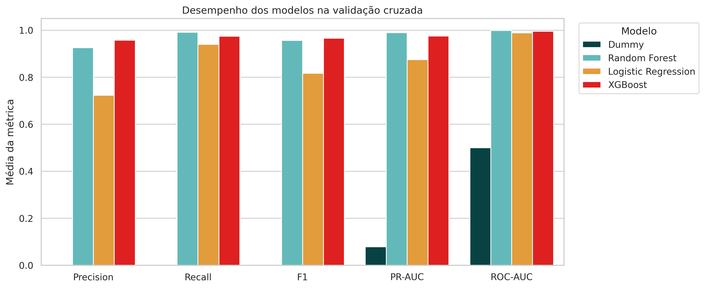

O XGBoost apresentou o maior F1 médio (0,966), enquanto o Random Forest
obteve o maior Recall (0,991), PR-AUC (0,990) e ROC-AUC (0,999). Os dois
modelos foram mantidos como finalistas por apresentarem desempenho
elevado e características complementares.

## 8. Interpretação dos modelos

### 8.1 Importância por permutação

A importância por permutação foi calculada nos folds internos do
treinamento. Em cada fold, o pipeline foi ajustado na parcela de
treinamento e a importância foi avaliada na parcela de validação
correspondente. O conjunto reservado permaneceu intocado.

O TSH apresentou a maior importância entre os preditores nos três
modelos preditivos: 0,796 no XGBoost, 0,767 no Random Forest e 0,687 na
Regressão Logística. A variável `on thyroxine` ocupou a segunda posição
nos três modelos. `thyroid surgery` apresentou maior relevância nos
modelos baseados em árvores, enquanto TT4 e T4U demonstraram maior
importância relativa na Regressão Logística.

**Figura 13 --- Importância por permutação dos preditores nos modelos.**

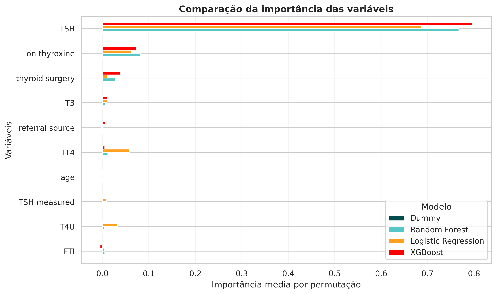

A convergência dos modelos quanto à predominância do TSH motivou um
experimento de sensibilidade. A importância por permutação representa
contribuição preditiva no contexto do modelo e dos dados utilizados; não
representa efeito causal ou relevância clínica independente.

### 8.2 Análise de sensibilidade sem TSH

Foi realizado um experimento retirando a variável `TSH` e mantendo os
demais preditores e parâmetros. A avaliação continuou restrita à
validação cruzada no conjunto de treinamento.

  Modelo                  F1 com TSH   F1 sem TSH   PR-AUC sem TSH   ROC-AUC sem TSH

  --------------------- ------------ ------------ ---------------- -----------------

  Regressão Logística          0,817        0,372            0,539             0,877
  Random Forest                0,957        0,493            0,545             0,865
  XGBoost                      0,966        0,439            0,558             0,867

**Figura 14 --- Sensibilidade dos modelos à retirada de TSH.**

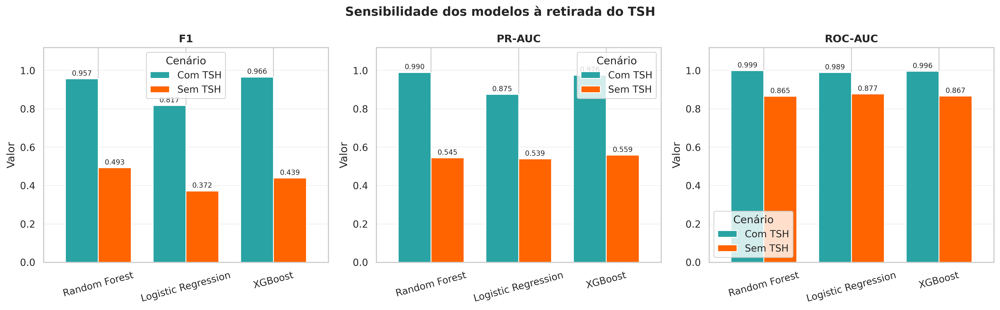

A retirada de TSH provocou redução expressiva do desempenho dos três
modelos. O F1 do XGBoost caiu de 0,966 para 0,439; o Random Forest
passou de 0,957 para 0,493; e a Regressão Logística, de 0,817 para
0,372.

A PR-AUC também apresentou queda acentuada. No cenário sem TSH, os
valores ficaram entre 0,539 e 0,558, indicando perda importante da
capacidade de ordenação dos registros positivos.

### 8.3 Importância das variáveis sem TSH

Após a retirada de TSH, a contribuição preditiva foi redistribuída entre
os demais atributos. TT4, FTI e T3 passaram a concentrar as maiores
importâncias nos três modelos avaliados. TT4 apresentou a maior
importância na Regressão Logística e no XGBoost, enquanto FTI ocupou
essa posição no Random Forest, com valor próximo ao de TT4. T3 manteve a
terceira posição nos três modelos.

**Figura 15 --- Importância por permutação no cenário sem TSH.**

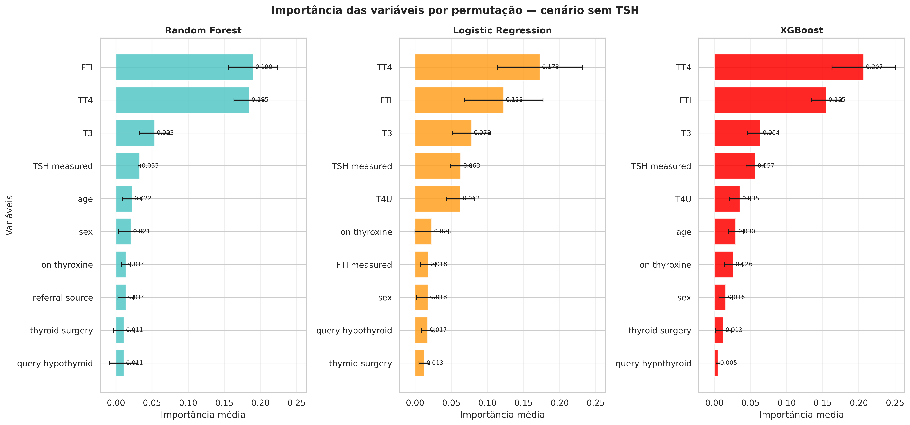

Apesar da contribuição dos demais indicadores laboratoriais, eles não
compensaram integralmente a retirada de TSH, conforme demonstrado pela
redução das métricas.

### 8.4 Associação entre variáveis categóricas e a classe

A associação entre variáveis categóricas e `binaryClass` foi investigada
por meio do V de Cramer, acompanhado dos testes estatísticos
correspondentes. `on thyroxine` e `query hypothyroid` apresentaram
evidência estatística de associação com a classe, ambas com p-valores
inferiores a 0,001. Entretanto, os valores de V de Cramer foram baixos:
0,082 e 0,095, respectivamente.

As variáveis `thyroid surgery`, `goitre` e `TT4 measured` não
apresentaram associação estatisticamente significativa ao nível de 5%.

**Figura 16 --- Associação entre variáveis categóricas e a classe,
medida pelo V de Cramer.**

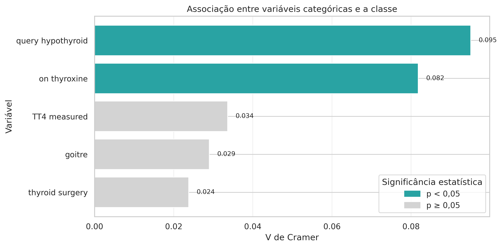

A significância estatística não implica associação forte. Os valores de
V de Cramer indicam baixa intensidade nas associações identificadas.

## 9. Seleção dos modelos finalistas

A seleção foi fundamentada nos resultados da validação cruzada, sem
utilizar o conjunto reservado para orientar escolhas ou ajustes. XGBoost
e Random Forest foram selecionados para a avaliação final.

O XGBoost apresentou maior F1 médio, enquanto o Random Forest obteve
maior Recall e PR-AUC. A manutenção dos dois finalistas permitiu
comparar modelos com características distintas, sem estabelecer
antecipadamente uma superioridade absoluta.

**Figura 17 --- Comparação dos modelos finalistas na validação
cruzada.**

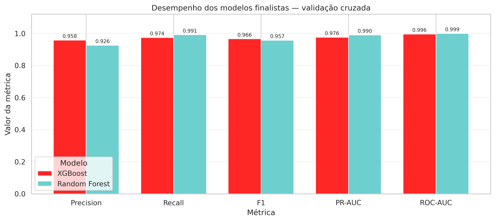

## 10. Avaliação final na validação reservada

Após a seleção, os modelos finalistas foram ajustados com todo o
conjunto de treinamento e avaliados nos 743 registros reservados. Esse
conjunto não participou da validação cruzada, da seleção dos modelos ou
da análise de importância.

### 10.1 Métricas finais

  Modelo            Precision   Recall      F1   PR-AUC   ROC-AUC

  --------------- ----------- -------- ------- -------- ---------

  XGBoost               1,000    0,983   0,991    1,000     1,000
  Random Forest         0,983    1,000   0,992    1,000     1,000

**Figura 18 --- Métricas dos modelos finalistas na validação
reservada.**

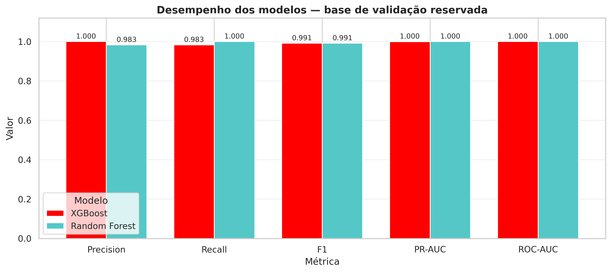

Os dois modelos apresentaram resultados muito próximos. O XGBoost obteve
Precision de 1,000 e Recall de 0,983. O Random Forest alcançou Precision
de 0,983 e Recall de 1,000. Os valores de F1 foram 0,991 e 0,992,
respectivamente.

### 10.2 Matrizes de confusão

As matrizes de confusão permitem observar a distribuição dos erros entre
as classes. Considerando `N` como classe positiva, os resultados foram:

**XGBoost**

  Classe real     Predito P   Predito N

  ------------- ----------- -----------

  P                     685           0
  N                       1          57

**Random Forest**

  Classe real     Predito P   Predito N

  ------------- ----------- -----------

  P                     684           1
  N                       0          58

**Figura 19 --- Matrizes de confusão dos modelos finalistas.**

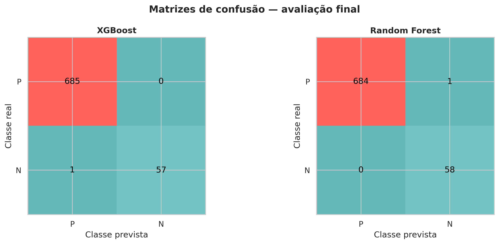

Cada modelo apresentou apenas um erro de classificação. O XGBoost
registrou um falso negativo e nenhum falso positivo. O Random Forest
registrou um falso positivo e nenhum falso negativo. Portanto, o XGBoost
não classificou incorretamente registros da classe `P` como `N`,
enquanto o Random Forest identificou todos os 58 registros positivos da
validação reservada.

A diferença reflete o equilíbrio entre Precision e Recall observado nos
modelos. Com base nessa avaliação, não há evidência suficiente para
declarar superioridade absoluta de um dos finalistas.

## 11. Discussão

Os resultados da EDA e da modelagem apontam para a importância dos
indicadores laboratoriais na reprodução da variável-alvo. A diferença
entre as medianas de TSH nas classes e a predominância dessa variável na
importância por permutação são coerentes entre as etapas exploratória e
preditiva.

A análise de sensibilidade reforça essa interpretação: a retirada de TSH
provocou queda expressiva no desempenho de todos os modelos. TT4, FTI e
T3 preservaram informação discriminativa, mas não foram suficientes para
manter os resultados do cenário original.

As variáveis categóricas também apresentaram algumas associações com a
classe, mas com baixa intensidade segundo o V de Cramer. Assim, os
resultados não sustentam a interpretação de que uma única variável
categórica explique a classificação.

Na validação reservada, XGBoost e Random Forest alcançaram métricas
muito elevadas e cometeram apenas um erro cada. Contudo, o desempenho
excepcional deve ser interpretado à luz da origem dos dados e da
definição do alvo. A avaliação demonstra capacidade de reproduzir os
rótulos do conjunto avaliado, mas não estabelece validade clínica ou
generalização para outras populações.

## 12. Limitações e cuidados de interpretação

1. **Definição da variável-alvo:** a origem e o procedimento de
   construção de `binaryClass` não foram estabelecidos de forma
   independente. A predominância do TSH entre os preditores e a queda
   de desempenho sem essa variável justificam cautela. Caso o TSH tenha
   participado da definição dos rótulos, pode haver circularidade ou
   vazamento de informação. Os resultados disponíveis não permitem
   confirmar essa hipótese.
2. **Validação interna:** os 743 registros reservados pertencem à mesma
   base de origem dos dados de treinamento. Portanto, a avaliação é um
   holdout interno, não uma validação externa em outra população,
   instituição ou período.
3. **Tamanho da classe positiva:** a classe `N` possui 233 registros no
   treinamento e 58 na validação reservada. O número reduzido de
   positivos limita a precisão das estimativas e exige cautela na
   interpretação das métricas.
4. **Desbalanceamento:** a classe positiva é minoritária. Por isso, as
   métricas devem ser interpretadas em conjunto, sem utilizar acurácia
   isoladamente como critério de qualidade.
5. **Interpretação clínica:** os modelos foram avaliados quanto à
   reprodução dos rótulos presentes na base `Hypothyroid`. O desempenho
   obtido não comprova capacidade de diagnóstico clínico, não substitui
   avaliação profissional e não demonstra validade em contextos reais
   de atendimento.
6. **Importância dos atributos:** a importância por permutação descreve
   contribuição preditiva no contexto dos modelos ajustados. Não
   representa causalidade ou efeito clínico.
7. **Divisão dos dados:** os resultados finais correspondem a uma única
   divisão estratificada entre treinamento e validação. A generalização
   para outros contextos exigiria avaliação em dados independentes.

## 13. Conclusão

A análise exploratória identificou desbalanceamento da variável-alvo,
valores ausentes, duplicatas exatas, uma idade inválida e variáveis sem
informação útil para a modelagem. Também mostrou diferenças entre as
classes nos indicadores laboratoriais, especialmente em TSH, e
correlação positiva entre TT4 e FTI.

Na modelagem, XGBoost e Random Forest apresentaram os melhores
resultados na validação cruzada e foram selecionados para a avaliação
final. O XGBoost obteve F1 médio de 0,966, enquanto o Random Forest
alcançou Recall de 0,991 e PR-AUC de 0,990. Na validação reservada, os
dois modelos apresentaram F1 próximo de 0,99 e apenas um erro de
classificação cada.

A análise de importância por permutação identificou TSH como o principal
preditor nos modelos avaliados. A retirada dessa variável provocou
redução expressiva do desempenho, enquanto TT4, FTI e T3 passaram a
concentrar maior importância relativa no cenário alternativo. As
análises de associação categórica identificaram relações estatísticas de
baixa intensidade para `on thyroxine` e `query hypothyroid`.

Conclui-se que os modelos apresentam elevada capacidade de reproduzir a
classificação disponível na base analisada. Entretanto, a dependência de
TSH, a necessidade de esclarecer a origem da variável-alvo, o
desbalanceamento e a ausência de validação externa limitam o alcance dos
resultados. Assim, o projeto atende ao objetivo de análise exploratória
e comparação de modelos de classificação sobre os dados disponíveis, mas
não permite afirmar que os algoritmos constituam ferramentas
clinicamente validadas para diagnóstico de hipotireoidismo.

## Referências e materiais do projeto

- EBAC. **Proposta do projeto --- Diagnóstico de Hipotireoidismo**.
  Documento de planejamento fornecido para o desenvolvimento do
  trabalho.
- **Notebook 01 --- Análise Exploratória de Dados (EDA)**. Preparação,
  auditoria, análise exploratória e divisão dos conjuntos.
- **Notebook 02 --- Modelagem preditiva (ML)**. Pré-processamento,
  validação cruzada, interpretação dos modelos e avaliação final.
- Base de dados: `Hypothyroid.csv`.

------------------------------------------------------------------------

## Organização sugerida dos arquivos

```text
Diagnostico_hipotireoidismo/
├── app/
│   └── app.py
├── data/
│   ├── Hypothyroid.csv
│   ├── df_treino.csv
│   └── df_validacao.csv
├── docs/
│   ├── relatorio_geral.md
│   └── figuras/
├── models/
│   └── modelo_hipotireoidismo.joblib
├── notebook/
│   ├── 01_EDA.ipynb
│   └── 02_ML.ipynb
├── src/
│   ├── preprocessing.py
│   ├── utils.py
│   └── ml_utils.py
├── treinar_modelo.py
└── README.md
```

As referências às imagens neste relatório são relativas ao arquivo
`relatorio_geral.md`. Por isso, a pasta `figuras` deve permanecer no
mesmo diretório `docs`.

## 14. Aplicação demonstrativa e disponibilização do modelo

Após a conclusão das etapas analíticas, foi construída uma aplicação
interativa em Streamlit para demonstrar a utilização do pipeline final
de Random Forest. A aplicação não realiza treinamento, seleção de
modelos ou ajuste de parâmetros: carrega o artefato serializado e
executa inferências a partir dos campos informados na interface.

### 14.1 Fluxo de treinamento e inferência

O script `treinar_modelo.py`, localizado na raiz do projeto, reconstrói
o pipeline final definido no estudo, ajusta-o com os dados de
treinamento disponíveis em `data/df_treino.csv` e exporta o artefato
`models/modelo_hipotireoidismo.joblib`.

A função de codificação das variáveis binárias está centralizada em
`src/preprocessing.py`. Esse módulo compartilhado é importado tanto
pelo script de treinamento quanto pela aplicação, permitindo que o
`joblib` localize corretamente a função ao desserializar o pipeline.

A aplicação `app/app.py` carrega o artefato e organiza os dados
informados pelo usuário conforme os 26 preditores e a ordem esperada
pelo pipeline. Campos não informados são encaminhados como ausentes e
tratados pelas etapas de pré-processamento incorporadas ao modelo.

### 14.2 Interpretação da saída da aplicação

A interface apresenta a classe prevista e a saída de `predict_proba`
associada à classe `N`:

- **N — classe positiva:** registro rotulado como hipotireoidismo na
  variável `binaryClass`;
- **P — classe negativa:** registro rotulado como não hipotireoidismo.

O percentual apresentado é a probabilidade estimada pelo classificador
de pertencimento à classe `N`, de acordo com os padrões aprendidos na
base. Não deve ser interpretado como probabilidade clínica individual,
risco de adoecimento ou diagnóstico. O estudo não realizou calibração
clínica da probabilidade nem validação externa em população independente.

A aplicação inclui perfis ilustrativos para facilitar a experimentação.
Esses valores servem apenas para observar o comportamento do
classificador e não constituem limites laboratoriais ou recomendações
clínicas.

### 14.3 Importância dos preditores

A interpretação por permutação realizada durante a modelagem identificou
TSH como o preditor de maior contribuição para o desempenho dos modelos.
A retirada dessa variável provocou redução expressiva das métricas.
Sem TSH, TT4, FTI e T3 passaram a concentrar maior importância relativa.
Esses resultados descrevem contribuição preditiva no contexto dos dados
e dos modelos avaliados; não representam causalidade ou relevância
clínica independente.

### 14.4 Execução local da aplicação

Com o ambiente Python configurado e as dependências instaladas, o
artefato deve ser gerado na raiz do projeto:

```bash
python treinar_modelo.py
```

Em seguida, a aplicação pode ser iniciada com:

```bash
python -m streamlit run app/app.py
```

Treinamento e inferência devem utilizar versões compatíveis das
bibliotecas, especialmente `scikit-learn`, uma vez que o pipeline é
serializado com `joblib`. A aplicação depende do arquivo
`models/modelo_hipotireoidismo.joblib` e do módulo
`src/preprocessing.py`.

A aplicação é uma camada demonstrativa complementar aos notebooks e
ao relatório. Ela não altera os resultados analíticos nem amplia o
escopo do estudo para diagnóstico clínico.
